# Class Activity 1 — System Calls in Practice

- **Student Name:** Kry Menghong
- **Student ID:** e20230343
- **Date:** [19-October-2026]

---

## Warm-Up: Hello System Call

Screenshot of running `hello_syscall.c` on Linux:

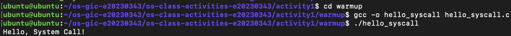

Screenshot of running `hello_winapi.c` on Windows (CMD/PowerShell/VS Code):

> Not run: I work on a MacBook (Apple silicon) with an Ubuntu VM in Multipass and have no Windows machine, so the WinAPI program cannot be compiled and run natively. The source is included in `warmup/hello_winapi.c`.

Screenshot of running `copyfilesyscall.c` on Linux:

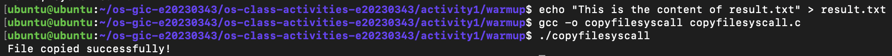

---

## Task 1: File Creator & Reader

### Part A — File Creator

**Describe your implementation:** The system call version does by hand what `fopen`/`fprintf`/`printf` hide: I call `open()` with explicit flags and permissions, `write()` the text with its exact byte length (`strlen`), `close()` the descriptor, and print the confirmation with `write(1, ...)`. There is no `FILE*`, no buffering and no format string; errors are written to fd 2 myself instead of using `perror()`. Both versions print the same line and create the same 36-byte `output.txt`.

**Version A — Library Functions (`file_creator_lib.c`):**

<!-- Screenshot: gcc -o file_creator_lib file_creator_lib.c && ./file_creator_lib && cat output.txt -->
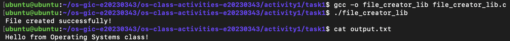

**Version B — POSIX System Calls (`file_creator_sys.c`):**

<!-- Screenshot: gcc -o file_creator_sys file_creator_sys.c && ./file_creator_sys && cat output.txt -->
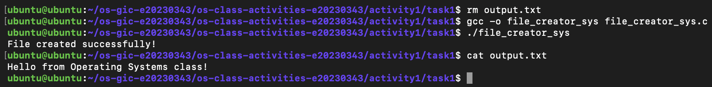

**Questions:**

1. **What flags did you pass to `open()`? What does each flag mean?**

   > `O_WRONLY | O_CREAT | O_TRUNC`. `O_WRONLY` opens the file for writing only. `O_CREAT` creates the file if it does not exist (this is why the third `mode` argument is needed). `O_TRUNC` empties the file to length 0 if it already exists, so old content is overwritten.

2. **What is `0644`? What does each digit represent?**

   > It is the permission mode in octal. The leading `0` marks it as octal. `6` = owner read+write (4+2), `4` = group read only, `4` = others read only, i.e. `rw-r--r--`. The final permissions are also filtered by the process `umask`.

3. **What does `fopen("output.txt", "w")` do internally that you had to do manually?**

   > It translates the mode string `"w"` into the flags `O_WRONLY|O_CREAT|O_TRUNC`, picks the permission `0666` (the umask turns it into `0644`), calls `open()`/`openat()`, and wraps the returned file descriptor in a `FILE` structure with a user-space buffer. `fprintf` then formats into that buffer and `fclose` flushes it with `write()` and calls `close()`. With system calls I had to choose the flags and mode, compute the byte count, and call `write()`/`close()` myself. My strace shows this: `openat(..., O_WRONLY|O_CREAT|O_TRUNC, 0666)` for the library version vs `0644` for mine.

### Part B — File Reader & Display

**Describe your implementation:** I open `output.txt` with `O_RDONLY`, then loop: `read()` up to 256 bytes into a buffer and `write()` exactly the number of bytes returned to fd 1. The loop stops when `read()` returns 0 (end of file) or -1 (error), then I `close()` the file. Unlike `fgets`/`printf`, the data is not treated as strings or lines, just raw bytes.

**Version A — Library Functions (`file_reader_lib.c`):**

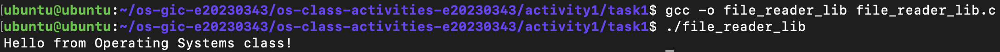

**Version B — POSIX System Calls (`file_reader_sys.c`):**

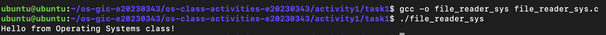

**Questions:**

1. **What does `read()` return? How is this different from `fgets()`?**

   > `read()` returns the number of bytes actually read (a `ssize_t`), `0` at end of file, or `-1` on error. It reads raw bytes and does not stop at a newline or add a `'\0'`. `fgets()` is a library function that reads from a buffered `FILE*` up to and including a newline (or until the buffer is full), adds a terminating `'\0'`, and returns a pointer to the buffer or `NULL` at EOF/error.

2. **Why do you need a loop when using `read()`? When does it stop?**

   > One `read()` returns at most the buffer size (256 bytes), and it may return fewer bytes than requested, so a larger file needs several calls. The loop keeps reading and writing each chunk until `read()` returns `0` (end of file) or `-1` (error).

---

## Task 2: Directory Listing & File Info

**Describe your implementation:** I kept `opendir()`, `readdir()`, `stat()` and `closedir()`, but replaced every `printf` with `snprintf()` into a 512-byte buffer followed by `write(1, buffer, len)`. The same format strings (`%-30s %10ld`) are used, so the columns line up exactly like the library version.

### Version A — Library Functions (`dir_list_lib.c`)

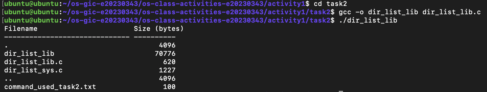

### Version B — System Calls (`dir_list_sys.c`)

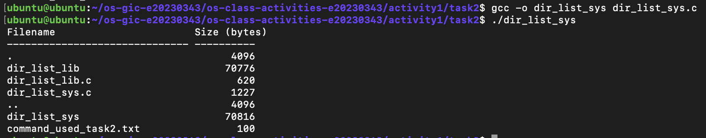

### Questions

1. **What struct does `readdir()` return? What fields does it contain?**

   > A pointer to a `struct dirent` (or `NULL` at the end of the directory). On Linux it contains `d_ino` (inode number), `d_off` (position of the next entry), `d_reclen` (length of this record), `d_type` (file type, e.g. `DT_REG`, `DT_DIR`) and `d_name` (the file name). Only `d_ino` and `d_name` are required by POSIX.

2. **What information does `stat()` provide beyond file size?**

   > `struct stat` also gives the file type and permissions (`st_mode`), inode number (`st_ino`), device (`st_dev`), number of hard links (`st_nlink`), owner and group IDs (`st_uid`, `st_gid`), block size and blocks allocated (`st_blksize`, `st_blocks`), and timestamps for last access, last modification and last status change (`st_atime`, `st_mtime`, `st_ctime`).

3. **Why can't you `write()` a number directly — why do you need `snprintf()` first?**

   > `write()` only copies raw bytes from memory. Writing a `long` directly would output its 8 binary bytes, not the readable digits. `snprintf()` converts the number to ASCII text (e.g. `"620"`), applies the padding/alignment, and gives the length to pass to `write()`.

---

## Optional Bonus: Windows API (`file_creator_win.c`)

Screenshot of running on Windows:

> Not run: no Windows machine available (MacBook + Ubuntu VM). The source is included in `task1/file_creator_win.c`, and the questions below are answered.

### Bonus Questions

1. **Why does Windows use `HANDLE` instead of integer file descriptors?**

   > A `HANDLE` is an opaque reference to a kernel object in the process's handle table. Windows uses one handle type for many kinds of objects (files, processes, threads, events, mutexes, registry keys), each with its own access rights and security checks, so it hides the internal value behind an opaque type instead of a small integer index. POSIX file descriptors are also indexes into a per-process table, but they are plain integers and are mainly used for file-like objects.

2. **What is the Windows equivalent of POSIX `fork()`? Why is it different?**

   > `CreateProcess()`. `fork()` duplicates the calling process (a copy that continues from the same point) and `exec()` then loads a new program. `CreateProcess()` creates a new process and loads a given program in one step, with no copy of the parent's memory. Windows was not designed around the fork model, and copying a whole address space is expensive.

3. **Can you use POSIX calls on Windows?**

   > Not natively through the Windows API, but yes through a compatibility layer: WSL runs a real Linux kernel (WSL2) or translates Linux system calls (WSL1), and Cygwin/MSYS2 provide a POSIX library (`cygwin1.dll`) that implements POSIX functions on top of WinAPI. MinGW and MSVC also provide a few POSIX-like functions such as `_open`/`_write`.

---

## Task 3: strace Analysis

**Describe what you observed:** [TODO from your output: e.g. "The library version made __ system calls and the system call version __. Both start with the same program-loading calls (execve, mmap, loading libc.so.6). The real work is identical: one openat, one write of 36 bytes, one close, one write to stdout. The library version adds fstat, brk, ioctl calls for its buffers."]

### strace Output — Library Version (File Creator)

<!-- Screenshot: strace -e trace=openat,read,write,close ./file_creator_lib -->
<!-- IMPORTANT: Highlight/annotate the key system calls in your screenshot -->
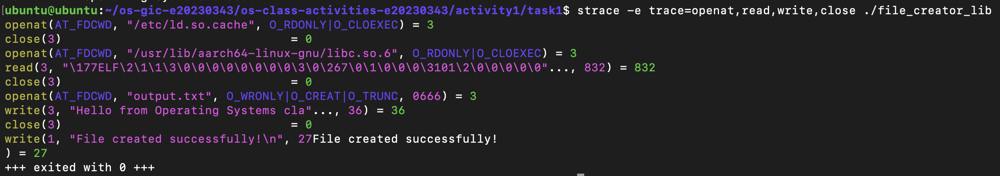

### strace Output — System Call Version (File Creator)

<!-- Screenshot: strace -e trace=openat,read,write,close ./file_creator_sys -->
<!-- IMPORTANT: Highlight/annotate the key system calls in your screenshot -->
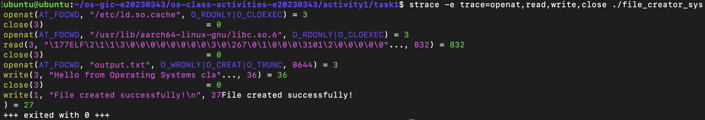

### strace Output — Library Version (File Reader or Dir Listing)

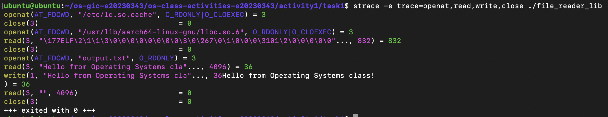

### strace Output — System Call Version (File Reader or Dir Listing)

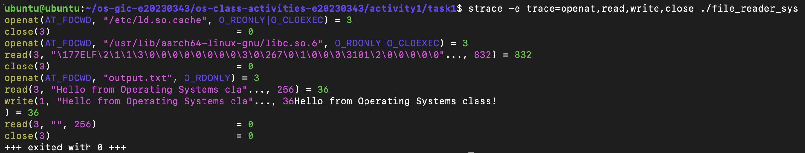

### strace -c Summary Comparison

<!-- Screenshot of `strace -c` output for both versions -->
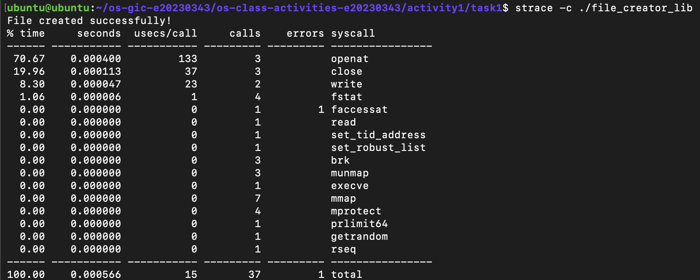
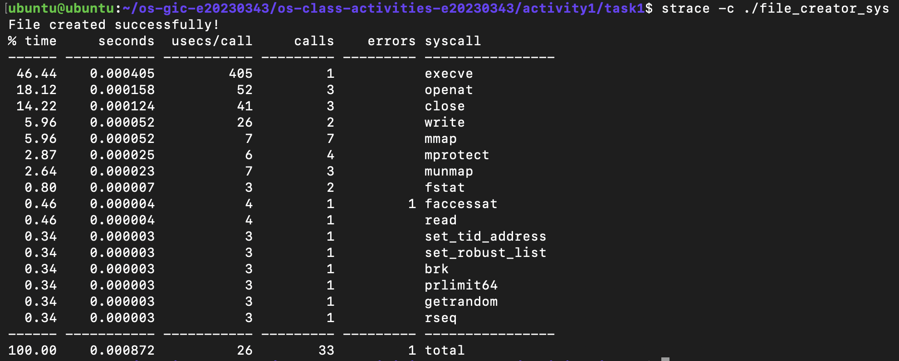

### Questions

1. **How many system calls does the library version make compared to the system call version?**

   > From `strace -c`: the library version (`file_creator_lib`) made **37** system calls (1 error) and the system call version (`file_creator_sys`) made **33** (1 error), so the library version made **4 more**. The 1 error in both is `faccessat`, the dynamic loader checking for `/etc/ld.so.preload`, which doesn't exist.

2. **What extra system calls appear in the library version? What do they do?**

   > Comparing the two `strace -c` tables, the extra calls are:
   > - `fstat`: **4** in lib vs **2** in sys (+2). `fopen`/`fprintf` call `fstat` on `output.txt`, and `printf` calls it on stdout, to find the file type and the best block size for the `FILE` buffer, and whether stdout is a terminal.
   > - `brk`: **3** in lib vs **1** in sys (+2). `brk` grows the heap. The library uses `malloc` to allocate the `FILE` structure and its I/O buffers, which needs more heap memory.
   >
   > Everything else (`execve`, `mmap` ×7, `mprotect` ×4, `munmap` ×3, `openat` ×3, `close` ×3, `read`, `getrandom`, `prlimit64`, `rseq`, `set_tid_address`, `set_robust_list`, `faccessat`) appears the same number of times in both. These come from starting a dynamically linked program and loading `libc.so.6`, not from my code.

3. **How many `write()` calls does `fprintf()` actually produce?**

   > Exactly **one**: `write(3, "Hello from Operating Systems cla"..., 36) = 36`. It appears right before `close(3)`, which means `fprintf` did not write immediately. It only copied the text into the `FILE` buffer in user space, and `fclose` flushed the whole buffer with one `write()` and then closed the file. The library version has 2 `write` calls in total, the same as my version (one to the file, one to the terminal). This matches what I expected: buffering means the number of `write()` system calls depends on when the buffer is flushed, not on how many times `fprintf` is called.

4. **In your own words, what is the real difference between a library function and a system call?**

   > A library function like `fprintf` or `fopen` is normal code that runs in user space inside libc. It does extra work for convenience: formatting, choosing flags and permissions, allocating and managing buffers. Only when it really needs the OS does it make a system call. A system call like `write` or `openat` is the actual request to the kernel: the CPU switches to kernel mode, the kernel touches the file or device, and returns. strace can only see system calls, and it shows that `fopen` → `openat`, `fprintf` + `fclose` → `write` + `close`, and `printf` → `write(1, ...)`. So library functions are wrappers built on top of system calls, and the extra `fstat`/`brk` calls are the cost of that convenience.

---

## Task 4: Exploring OS Structure

### System Information

> 📸 Screenshot of `uname -a`, `/proc/cpuinfo`, `/proc/meminfo`, `/proc/version`, `/proc/uptime`:

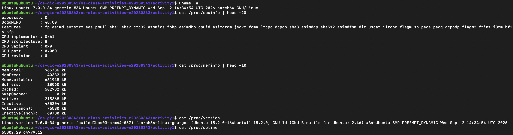

### Process Information

> 📸 Screenshot of `/proc/self/status`, `/proc/self/maps`, `ps aux`:

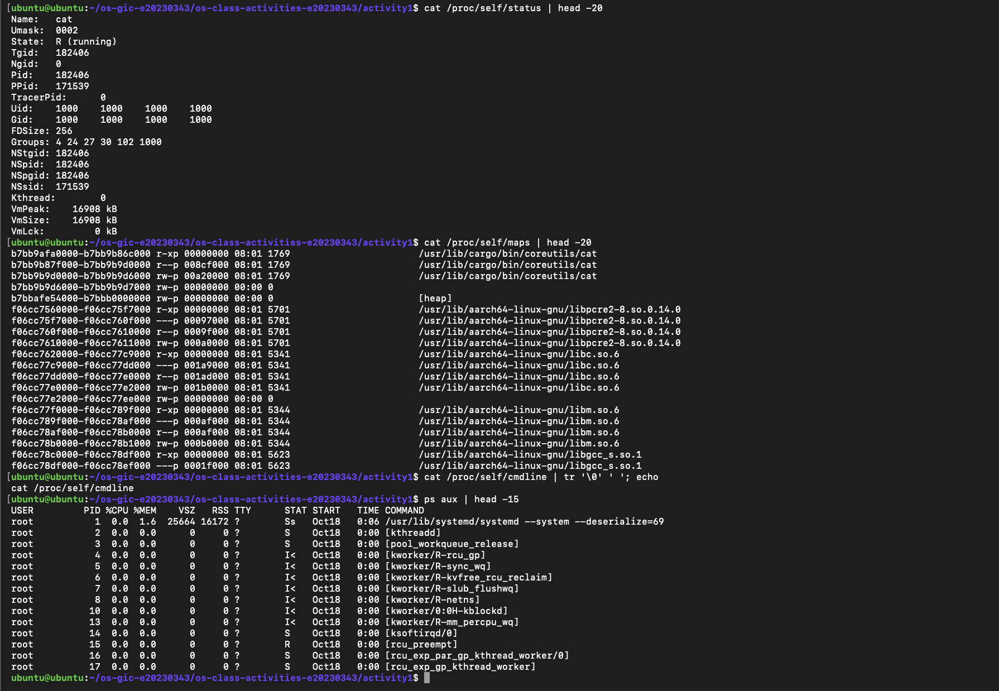

### Kernel Modules

> 📸 Screenshot of `lsmod` and `modinfo`:

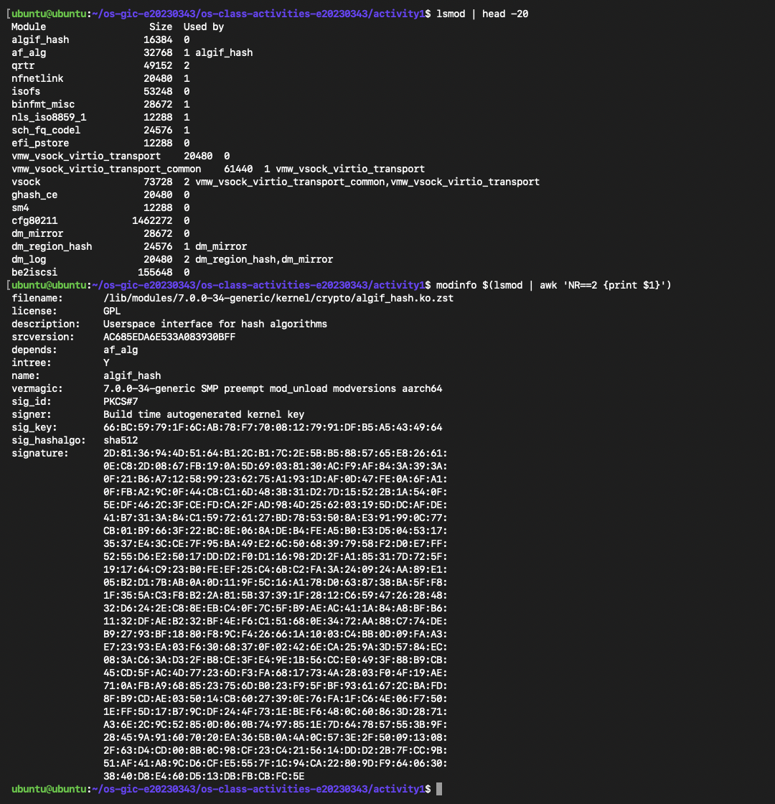

### OS Layers Diagram

> 📸 Your diagram of the OS layers, labeled with real data from your system:

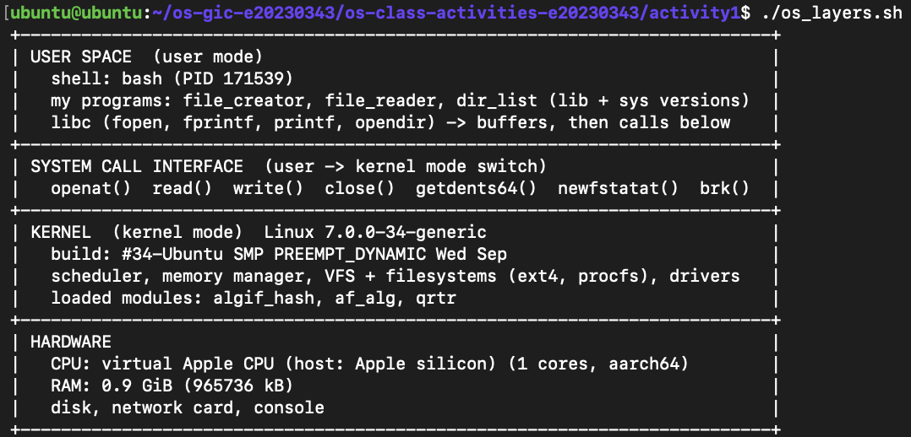

### Questions

1. **What is `/proc`? Is it a real filesystem on disk?**

   > `/proc` is a virtual (pseudo) filesystem of type `procfs`. It is not stored on disk: the files have size 0 and their content is generated by the kernel at the moment you read them, from the kernel's own data structures (process table, memory counters, CPU info, loaded modules).

2. **Monolithic kernel vs. microkernel — which type does Linux use?**

   > In a **monolithic kernel**, almost all OS services (process scheduling, memory management, file systems, device drivers, networking) run together in kernel space, in one address space and with full privileges. A **microkernel** keeps only the minimum in the kernel (IPC, basic scheduling, low-level memory management) and runs drivers and file systems as separate user-space servers that talk through messages. Linux is **monolithic, but modular**. My `lsmod` output shows loadable modules such as `algif_hash`, `af_alg`, `qrtr`, `isofs`, `vsock`, `cfg80211` and `dm_mirror` (19 in the first 20 lines alone). The "Used by" column shows modules depending on each other inside the kernel (`af_alg` is used by `algif_hash`, `dm_log` by `dm_region_hash` and `dm_mirror`). `modinfo algif_hash` shows it is a file `/lib/modules/7.0.0-34-generic/kernel/crypto/algif_hash.ko.zst` built for exactly this kernel (`vermagic: 7.0.0-34-generic SMP preempt mod_unload modversions aarch64`). Once loaded, it runs in kernel space with full privileges, not as a separate user-space server, so Linux stays monolithic even though parts can be added and removed at runtime.

3. **What memory regions do you see in `/proc/self/maps`?**

   > The process reading the file is `cat` itself (on this Ubuntu, `cat` is the Rust coreutils binary `/usr/lib/cargo/bin/coreutils/cat`). Its first 20 lines show:
   > - **Program code and data**: `/usr/lib/cargo/bin/coreutils/cat` three times: `r-xp` (executable code), `r--p` (read-only constants) and `rw-p` (writable global data).
   > - An **anonymous** `rw-p` region with no file (inode 0), used for uninitialised data (bss).
   > - The **`[heap]`** (`rw-p`), where `malloc` memory lives.
   > - **Shared libraries** at much higher addresses: `libpcre2-8.so.0`, `libc.so.6`, `libm.so.6` and `libgcc_s.so.1`. Each is mapped several times with different permissions: `r-xp` code, `---p` guard gap (no access), `r--p` read-only data, `rw-p` writable data.
   >
   > Each line shows the address range, permissions (r/w/x, p = private copy), file offset, device (`08:01` = the disk), inode and path. The `[stack]`, `[vdso]` and `[vvar]` regions are further down and are cut off by `head -20`. (`cat /proc/self/maps | grep -E 'stack|vdso|vvar'` shows them.)

4. **Break down the kernel version string from `uname -a`.**

   > My output: `Linux ubuntu 7.0.0-34-generic #34-Ubuntu SMP PREEMPT_DYNAMIC Wed Sep 2 14:34:54 UTC 2026 aarch64 GNU/Linux`
   > - `Linux`: kernel name.
   > - `ubuntu`: hostname of the machine (my Multipass VM).
   > - `7.0.0-34-generic`: kernel release. `7.0.0` = major.minor.patch, `34` = Ubuntu's ABI/package revision, `generic` = the standard Ubuntu kernel flavour.
   > - `#34-Ubuntu SMP PREEMPT_DYNAMIC Wed Sep 2 14:34:54 UTC 2026`: kernel build version. `#34-Ubuntu` is Ubuntu's build number, `SMP` = supports multiple processors, `PREEMPT_DYNAMIC` = the preemption model can be chosen at boot, followed by the date the kernel was compiled.
   > - `aarch64`: hardware architecture (64-bit ARM, because the VM runs on an Apple silicon Mac). This is also why `/proc/cpuinfo` shows `CPU implementer`/`CPU part` instead of a model name.
   > - `GNU/Linux`: the operating system (Linux kernel + GNU user-space tools).
   >
   > `/proc/version` adds that it was built by `buildd@bos03-arm64-067` with `aarch64-linux-gnu-gcc` 15.2.0.

5. **How does `/proc` show that the OS is an intermediary between programs and hardware?**

   > Programs like `cat` cannot touch the CPU registers, RAM chips or devices directly. When I ran `cat /proc/meminfo`, `cat` only made normal `openat()` and `read()` system calls, and the kernel produced the text on the spot from its own data: `MemTotal: 965736 kB` is the RAM the kernel manages for this VM, the CPU features in `/proc/cpuinfo` (`fp asimd aes sha2 …`) are what the kernel read from the processor, and `/proc/uptime` (`65302.20`) comes from the kernel's clock. `/proc/self/status` even shows the kernel's own record of my process (PID 182406, parent 171539 = my bash, state R). So the program never sees the hardware itself, only what the kernel exposes through the file interface: hardware → kernel → system calls → user program. The same `read()` I used in Task 1 works for these "files", which are really kernel data, not data stored on disk.

---

## Reflection

What did you learn from this activity? What was the most surprising difference between library functions and system calls?

> I learn that a lot about the command: 
>   - `multipass shell ubuntu`	Opens a terminal inside the VM named ubuntu.
>   - `multipass restart ubuntu`	Reboots the VM (also fixes a wrong clock).
>   - `multipass transfer <mac-file> ubuntu:<vm-path>`	Copies a file from the Mac into the VM
>   - `sudo apt update`	Downloads the latest list of available packages. sudo = run as administrator.
>   - `sudo apt install build-essential strace -y`	Installs gcc and friends (build-essential) and the strace tool. -y = answer "yes" automatically.
>   - `gcc --version`	Prints the compiler version, just to confirm it's installed.
>   - `date`	Shows the VM's current date/time.
>   - `gcc -o file_creator_sys file_creator_sys.c`	Compiles the C source file_creator_sys.c into a runnable program. -o sets the output name
>  - `./file_creator_sys`	Runs the program in the current folder. ./ = "this folder"; Linux doesn't look in the current folder by default.
>  - `strace ./program`	Runs the program and prints every system call it makes (the requests to the kernel).
>  - `-e trace=openat,read,write,close`	Show only these 4 kinds of system calls, hiding the rest.