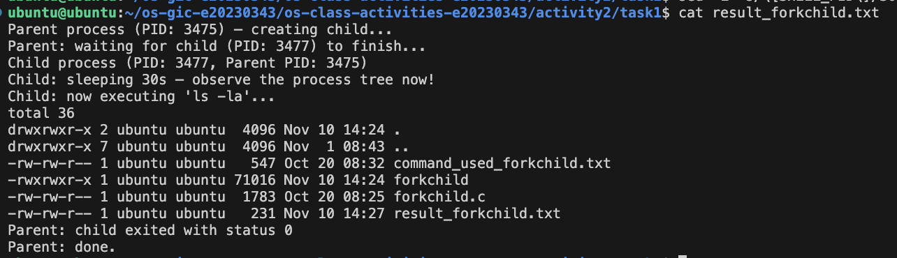
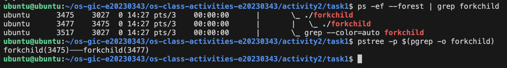
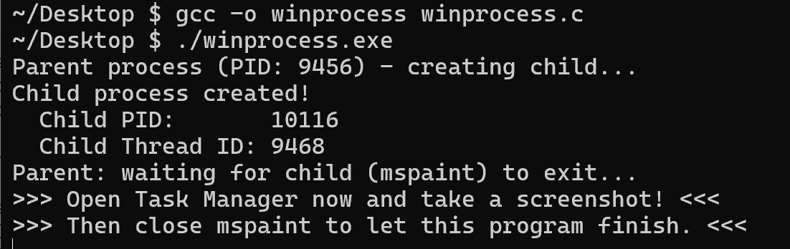
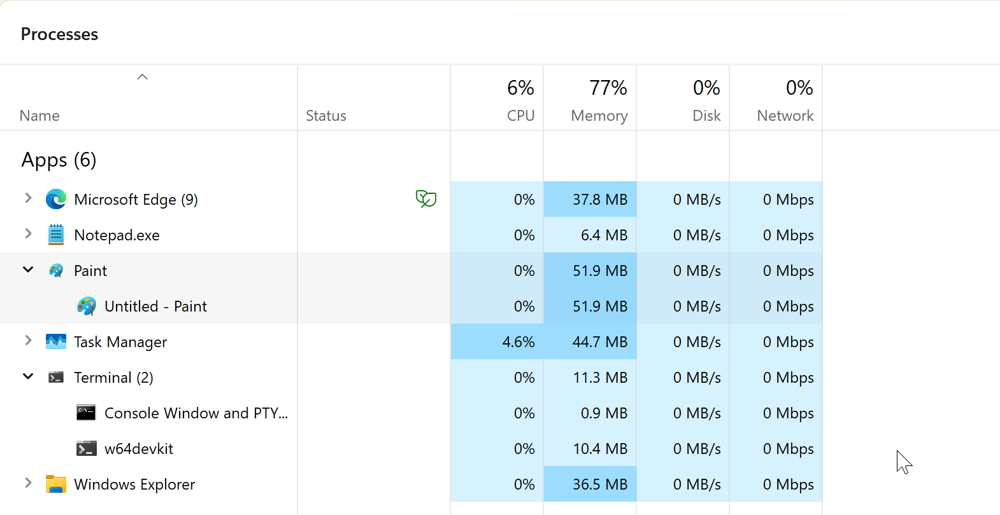
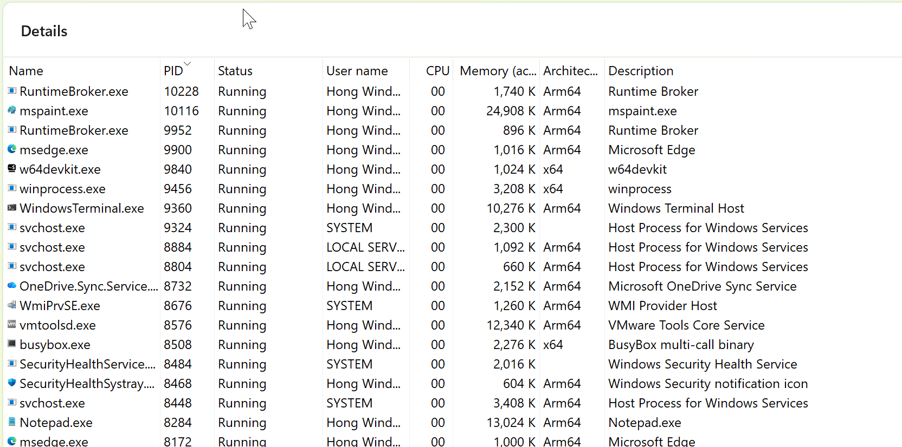
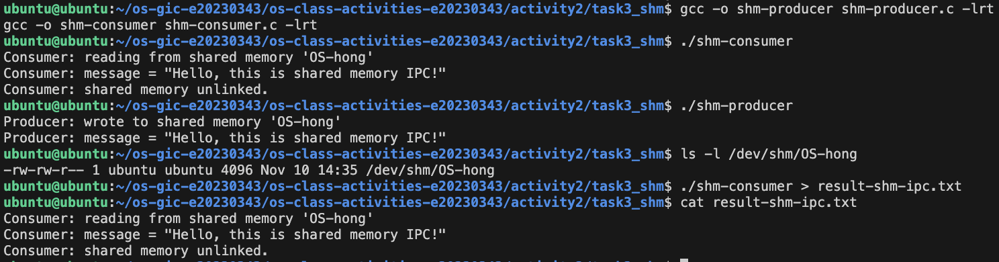
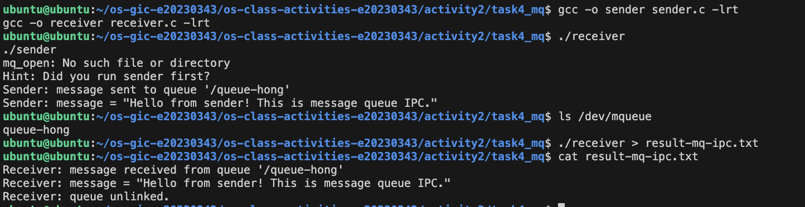

# Class Activity 2 — Processes & Inter-Process Communication

- **Student Name:** Kry Menghong
- **Student ID:** e20230343
- **Date:** 2026-11-10

---

## Task 1: Process Creation on Linux (fork + exec)

### Compilation & Execution

Screenshot of compiling and running `forkchild.c`:



### Process Tree

Screenshot of the parent-child process tree (using `ps --forest`, `pstree`, or `htop` tree view):



### Output

```
Parent process (PID: 194719) — creating child...
Parent: waiting for child (PID: 194720) to finish...
Child process (PID: 194720, Parent PID: 194719)
Child: sleeping 30s — observe the process tree now!
Child: now executing 'ls -la'...
total 32
drwxrwxr-x 2 ubuntu ubuntu  4096 Oct 20 08:25 .
drwxrwxr-x 7 ubuntu ubuntu  4096 Oct 20 08:25 ..
-rwxrwxr-x 1 ubuntu ubuntu 71016 Oct 20 08:25 forkchild
-rw-rw-r-- 1 ubuntu ubuntu  1783 Oct 20 08:25 forkchild.c
-rw-rw-r-- 1 ubuntu ubuntu   239 Oct 20 08:26 result_forkchild.txt
Parent: child exited with status 0
Parent: done.
```

> Note: I added `setvbuf(stdout, NULL, _IOLBF, 0);` at the start of `main()`. When the output is redirected to `result_forkchild.txt`, stdout is fully buffered, so without it the child's `printf` lines were still sitting in the buffer when `execlp()` replaced the program and were lost (and text buffered before `fork()` can be printed twice, once by each process). Line buffering writes each line out right away, so the file shows every line in the right order.

### Questions

1. **What does `fork()` return to the parent? What does it return to the child?**

   > `fork()` is called once but returns twice. In the parent it returns the PID of the new child (a positive number, 194720 in my run). In the child it returns `0`. If the child could not be created it returns `-1` in the parent and no child exists. The program uses this return value to decide which branch (parent or child code) to run.

2. **What happens if you remove the `waitpid()` call? Why might the output look different?**

   > The parent would not wait. It would print "Parent: done." and exit right away while the child is still sleeping, so the shell prompt comes back before the child's `ls -la` output, which then appears later, mixed into the terminal. The order of parent and child lines is decided by the scheduler, so it can change from run to run. The child also becomes an orphan: when the parent exits it is re-parented to `init`/`systemd` (PID 1, or a subreaper), so `getppid()` would no longer return the original parent. And without `wait` the parent cannot read the child's exit status; a child that ends while its parent is still alive and not waiting stays a zombie until it is reaped.

3. **What does `execlp()` do? Why don't we see "execlp failed" when it succeeds?**

   > `execlp()` replaces the current process image with a new program. It searches the `PATH` for `ls`, loads it into the child, and starts it with the arguments `"ls", "-la"` (the list ends with `NULL`). The PID stays the same, but the code, data, heap and stack of `forkchild` are thrown away. Because the old program no longer exists, `execlp()` never returns on success, so the `perror("execlp")` line after it is never reached. It only runs if `execlp()` fails (for example, the command is not found), in which case it returns `-1`.

4. **Draw the process tree for your program (parent → child). Include PIDs from your output.**

   > ```
   > bash (my shell)
   >  └── ./forkchild  parent  (PID 194719)
   >       └── ./forkchild  child  (PID 194720, PPID 194719)
   >            └── after execlp(): same PID 194720, now running "ls -la"
   > ```
   > The child's PPID equals the parent's PID, which matches the `ps -ef --forest` screenshot.

5. **Which command did you use to view the process tree (`ps --forest`, `pstree`, or `htop`)? What information does each column show?**

   > I used `ps -ef --forest | grep forkchild` (and `pstree -p` to confirm). The columns of `ps -ef` are: **UID** (user who owns the process), **PID** (process ID), **PPID** (parent process ID), **C** (recent CPU usage), **STIME** (start time), **TTY** (terminal it is attached to, e.g. `pts/0`), **TIME** (total CPU time used) and **CMD** (the command). `--forest` draws the `\_` lines that indent a child under its parent. `pstree -p` shows only the names and PIDs as a tree, e.g. `forkchild(194719)───forkchild(194720)`.

---

## Task 2: Process Creation on Windows

### Compilation & Execution

Run on a Windows 11 ARM64 VM (VMware Fusion on my Mac), compiled with gcc from w64devkit.

> Note: the sheet's path `C:\\Windows\\System32\\mspaint.exe` failed with `CreateProcess failed (error 2)` (file not found). On Windows 11, Paint is a Microsoft Store app; `where mspaint` shows it at `%LOCALAPPDATA%\Microsoft\WindowsApps\mspaint.exe`. So I pass `NULL` as the application name and `"mspaint.exe"` as the command line, and `CreateProcess()` searches the PATH for it.

Screenshot of compiling and running `winprocess.c`:



### Task Manager Screenshots

Screenshot showing process tree in the **Processes** tab (mspaint nested under your program):



Screenshot showing PID and Parent PID in the **Details** tab (the Windows 11 Task Manager has no Parent PID column, so the parent PID is shown with PowerShell next to it):



### Questions

1. **What is the key difference between how Linux creates a process (`fork` + `exec`) and how Windows does it (`CreateProcess`)?**

   > Linux uses two steps: `fork()` makes a copy of the parent (same code and data, copy-on-write), and then `exec()` replaces that copy with a new program. Between the two calls the child can change its own setup (redirect files, change directory) before the new program starts. Windows uses one step: `CreateProcess()` creates a brand-new process and loads the named program (`mspaint.exe`) directly, with nothing copied from the parent's memory. Everything about the child is given as parameters (command line, flags, environment, working directory, `STARTUPINFO`), and the parent gets back `HANDLE`s plus the PID and thread ID in `PROCESS_INFORMATION`.

2. **What does `WaitForSingleObject()` do? What is its Linux equivalent?**

   > It blocks the calling thread until the given kernel object becomes signaled or the timeout ends. A process handle becomes signaled when the process exits, so `WaitForSingleObject(pi.hProcess, INFINITE)` makes the parent wait until mspaint is closed. The Linux equivalent is `wait()` / `waitpid()`, as used in Task 1. (The exit code is then read separately with `GetExitCodeProcess()`, while `waitpid()` returns it in `status`.)

3. **Why do we need to call `CloseHandle()` at the end? What happens if we don't?**

   > `CreateProcess()` opens two handles for the parent: one to the child process and one to its main thread. Each handle is an entry in the parent's handle table and keeps a reference to the kernel object. `CloseHandle()` releases them. Closing the handle does not kill mspaint; it only says the parent no longer needs it. If we don't close them, the handles leak: the kernel cannot free the process/thread objects even after mspaint exits, and a long-running program that keeps creating processes would use up handles and memory. In this small program Windows closes them anyway when the program exits, but closing them yourself is the correct practice.

4. **In Task Manager, what was the PID of your parent program and the PID of mspaint? Do they match your program's output?**

   > Yes, they match. My program printed `Parent process (PID: 9456)` and `Child PID: 10116` (thread ID 9468). In the Task Manager Details tab, `winprocess.exe` has PID **9456** and `mspaint.exe` has PID **10116**. The Windows 11 Task Manager has no Parent PID column, so I checked the parent with PowerShell (`Get-CimInstance Win32_Process ... | Select-Object Name, ProcessId, ParentProcessId`): `mspaint.exe` 10116 has ParentProcessId **9456**, which is `winprocess.exe`. `winprocess.exe` itself has parent 6372, the w64devkit shell I started it from.

5. **Compare the Processes tab (tree view) and the Details tab (PID/PPID columns). Which view makes it easier to understand the parent-child relationship? Why?**

   > The Details tab (plus the parent PID from PowerShell) made the relationship clearer for me. On Windows 11 the Processes tab groups windows by **app**, not by parent process: Paint is a Microsoft Store app, so it appeared as its own "Paint" entry instead of being nested under Terminal/w64devkit, even though my program created it. The tree view is quick to read, but it shows which app a window belongs to, not who created it. The PID/Parent PID numbers are exact: `mspaint.exe` 10116 has parent 9456 = `winprocess.exe`, which proves the parent-child link, just like PPID does in `ps -ef` on Linux.

---

## Task 3: Shared Memory IPC

Shared memory name used: `OS-hong`.

### Compilation & Execution

Screenshot of compiling and running `shm-producer` and `shm-consumer`:



### Output

```
Consumer: reading from shared memory 'OS-hong'
Consumer: message = "Hello, this is shared memory IPC!"
Consumer: shared memory unlinked.
```

### Questions

1. **What does `shm_open()` do? How is it different from `open()`?**

   > `shm_open()` creates or opens a named POSIX shared memory object and returns a file descriptor for it. On Linux the object lives in the RAM-based `tmpfs` at `/dev/shm` (my producer created `/dev/shm/OS-hong`), so it is memory, not a file on disk. A new object has size 0, so it must be sized with `ftruncate()` and then mapped with `mmap()` before it can be used. `open()` opens a regular file by its path on the file system, and the data is normally read and written with `read()`/`write()`. `shm_open()` takes a name like `"OS-hong"` (not a full path) and is meant to be shared between processes through `mmap()`.

2. **What does `mmap()` do? Why is shared memory faster than other IPC methods?**

   > `mmap()` maps an object (here the shared memory fd) into the process's virtual address space and returns a pointer to it. With `MAP_SHARED`, the producer's and consumer's pointers both point to the same physical pages, so a write through one is seen by the other. It is the fastest IPC because after the setup there are no system calls and no copying: the processes read and write the memory directly with normal pointer operations. Pipes and message queues need a system call per transfer, and the data is copied from the sender into the kernel and from the kernel into the receiver.

3. **Why must the shared memory name match between producer and consumer?**

   > The name is how two unrelated processes find the same object; it is the key the kernel uses to look it up (the file `/dev/shm/OS-hong`). If the consumer uses a different name, it either fails with "No such file or directory" or opens a different, empty object. Using my own name also avoids clashing with other students on the same machine.

4. **What does `shm_unlink()` do? What would happen if the consumer didn't call it?**

   > `shm_unlink()` removes the name of the shared memory object. The memory is freed when the last process that has it mapped unmaps it. If the consumer didn't call it, the object would stay in `/dev/shm` after both programs exit, using RAM until someone removes it (`rm /dev/shm/OS-hong`) or the system reboots. Running the consumer again would still read the old message. When I ran the consumer a second time after it had unlinked the object, it failed with `shm_open: No such file or directory`, which shows the object was really removed.

5. **If the consumer runs before the producer, what happens? Try it and describe the error.**

   > It fails: `shm_open(name, O_RDONLY, ...)` does not use `O_CREAT`, so it cannot create the object and returns `-1`. The program prints:
   > ```
   > shm_open: No such file or directory
   > Hint: Did you run shm-producer first?
   > ```
   > and exits with status 1. `errno` is `ENOENT` because no object named `OS-hong` exists yet. Shared memory does not wait for data; the consumer just reads whatever is there, so the producer must run first.

---

## Task 4: Message Queue IPC

Queue name used: `/queue-hong`.

### Compilation & Execution

Screenshot of compiling and running `sender` and `receiver`:



### Output

```
Receiver: message received from queue '/queue-hong'
Receiver: message = "Hello from sender! This is message queue IPC."
Receiver: queue unlinked.
```

### Questions

1. **How is a message queue different from shared memory? When would you use one over the other?**

   > In shared memory, the processes share one memory region and read/write it directly; the kernel is not involved after setup, so it is the fastest, but there are no message boundaries and no synchronization: the programs must add semaphores or mutexes themselves to avoid reading while the other writes. A message queue is managed by the kernel: each `mq_send()` copies a whole message into the queue and each `mq_receive()` copies one out, in order (by priority, then FIFO). It keeps message boundaries and blocks the receiver until a message is there (or the sender when the queue is full), so synchronization is built in, but every message costs system calls and copies. Use shared memory for large amounts of data or very frequent updates (images, buffers, a shared table). Use a message queue for small, separate messages such as commands, events or jobs, where simplicity and ordering matter more than speed.

2. **Why does the queue name in `common.h` need to start with `/`?**

   > POSIX requires a message queue name to be of the form `/somename`: one leading slash followed by characters that are not slashes. On Linux the queues live in a special file system usually mounted at `/dev/mqueue`, and the name is the entry in that directory (`/dev/mqueue/queue-hong`). Without the leading `/`, `mq_open()` fails with `EINVAL` (Invalid argument).

3. **What does `mq_unlink()` do? What happens if neither the sender nor receiver calls it?**

   > `mq_unlink()` removes the queue's name; the queue itself is destroyed once every process that has it open has called `mq_close()`. `mq_close()` alone only closes this process's descriptor. If nobody calls `mq_unlink()`, the queue stays in the kernel (visible in `/dev/mqueue`) after both programs exit, together with any unread messages, until it is unlinked or the system reboots. The next run would reuse it, so old messages could be received, and if senders keep sending without a receiver it fills up (10 messages here) and `mq_send()` blocks. In my test, I ran the sender twice and the receiver once: the receiver read one message and then unlinked the queue, so the second message was thrown away with it.

4. **What happens if you run the receiver before the sender?**

   > The receiver calls `mq_open(QUEUE_NAME, O_RDONLY)` without `O_CREAT`, so if the queue does not exist yet it fails and prints:
   > ```
   > mq_open: No such file or directory
   > Hint: Did you run sender first?
   > ```
   > If the queue already existed but was empty (for example, opened with `O_CREAT` by the receiver), `mq_receive()` would block, waiting until a sender puts a message in, because the queue is in blocking mode (`mq_flags = 0`).

5. **Can multiple senders send to the same queue? Can multiple receivers read from the same queue?**

   > Yes to both. Any number of processes can open the same queue by name. Several senders can `mq_send()` to it, and their messages are queued in order (higher priority first, FIFO within the same priority). Several receivers can also `mq_receive()` from it, but each message is delivered to only one receiver: once a receiver takes a message it is removed from the queue, so the receivers share the work instead of all getting a copy. (It is not a broadcast.) In this program the receiver also calls `mq_unlink()`, so with several receivers the first one would remove the queue name for the others.

---

## Reflection

What did you learn from this activity? What was the most interesting difference between Linux and Windows process creation? Which IPC method do you prefer and why?

> [Write your reflection here, in your own words. Ideas: fork() returning twice was surprising; output redirection showed how stdio buffering interacts with fork/exec; Windows' one-call CreateProcess vs Linux's copy-then-replace; shared memory is fastest but needs your own synchronization, while the message queue was easier to use correctly.]
