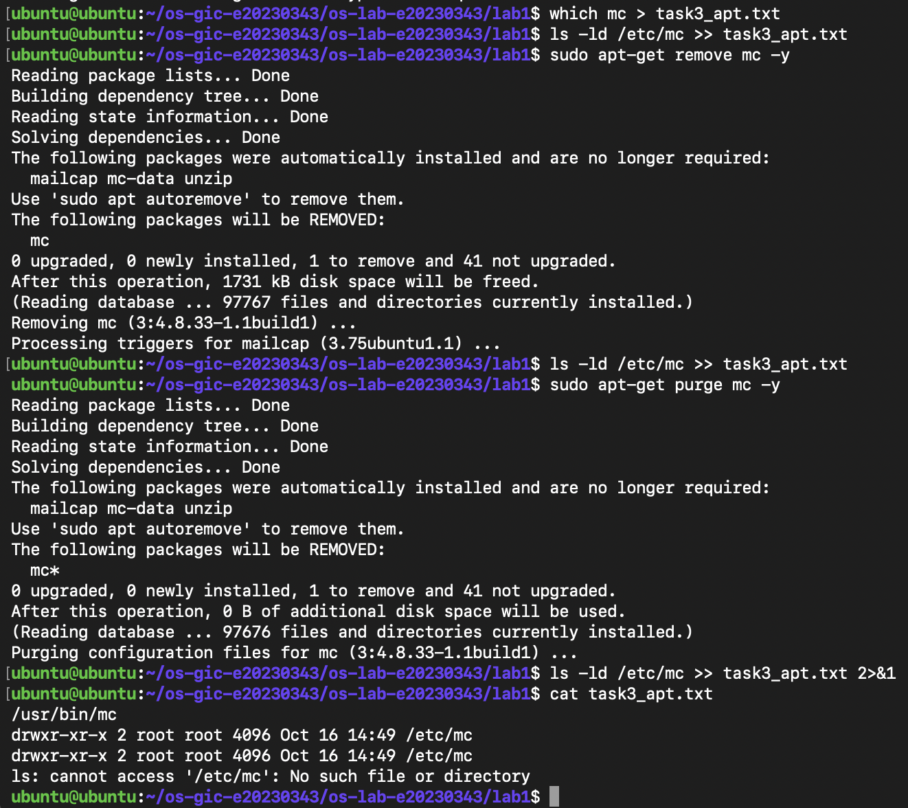
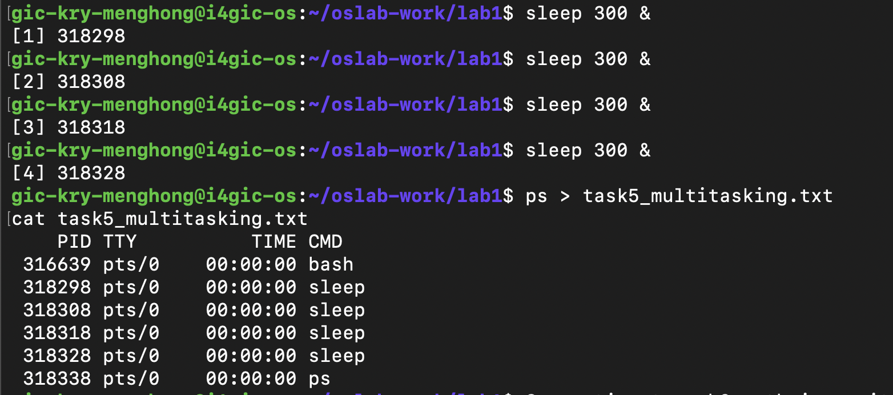
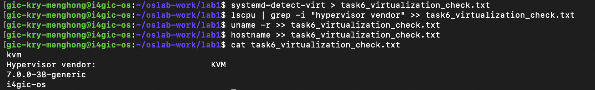

# OS Lab 1 Submission

Copy this template to `os-lab-YOUR_ID/lab1/README.md` in your own repository. Follow [the instructions](lab1-instruction.md). Your prediction and checkpoint answers are already saved by `oslab`; do not copy them here.

- **Student Name:** Kry Menghong
- **Student ID:** e20230343
- **Ubuntu username on the server:** gic-kry-menghong
- **My values** (`oslab values lab1`): file1 = ocean, file2 = cloud, count = 4

---

## Task 1: Operating System Identification

Briefly describe what you observed about your OS and kernel. Which number is the kernel version, and which is the distribution version?

The server runs Linux with Ubuntu as the distribution. In `uname -a`, the number after the hostname is the kernel version: **TODO: kernel version, e.g. 6.x.y-xx-generic**. In `lsb_release -a`, the `Release:` line is the Ubuntu (distribution) version: **TODO: e.g. 24.04**. The kernel is the core of the OS that talks to the hardware, while the distribution is the whole system (kernel plus tools and packages) built around it, so the two have different version numbers.

<!-- You may show the contents of task1_os_info.txt here; no screenshot needed. -->

```text
Linux i4gic-os 7.0.0-38-generic #38-Ubuntu SMP PREEMPT_DYNAMIC Fri Sep  4 09:10:14 UTC 2026 x86_64 GNU/Linux
Distributor ID:	Ubuntu
Description:	Ubuntu 26.04.1 LTS
Release:	26.04
Codename:	resolute

```

---

## Task 2: Essential Linux File and Directory Commands

Briefly describe your experience creating, copying, renaming and deleting files. What did the last `ls` show?

Inside `task2_files` I used `touch` to create `ocean.txt` and `cloud.txt`, `echo` with `>` to write a line into each, `cp` to copy `ocean.txt` to `ocean_copy.txt`, `mv` to rename `cloud.txt` to `cloud_renamed.txt`, and `rm` to delete the copy. After each step I saved `ls` into `task2_file_commands.txt` with `>>`, so I could see the folder change. I learned to use `>` only for the first line, because `>` overwrites the file and `>>` adds to the end.

The last `ls` showed: **TODO: confirm from your file, expected `cloud_renamed.txt  ocean.txt`**

<!-- You may show the contents of task2_file_commands.txt here; no screenshot needed. -->

```text
/home/gic-kry-menghong/oslab-work/lab1/task2_files
cloud.txt
ocean.txt
This is file ocean
This is file cloud
cloud.txt
ocean.txt
ocean_copy.txt
cloud_renamed.txt
ocean.txt
ocean_copy.txt
cloud_renamed.txt
ocean.txt

```

---

## Task 3: Package Management Using APT

Explain the difference you observed between `remove` and `purge`.

I did this task on my own Ubuntu (a Multipass VM on my Mac). After `sudo apt-get install mc`, `which mc` showed `/usr/bin/mc` and the folder `/etc/mc` existed. After `sudo apt-get remove mc`, the program was gone but `/etc/mc` was still there. Only after `sudo apt-get purge mc` did `ls -ld /etc/mc` say `No such file or directory`. So `remove` deletes the program but keeps its configuration files in `/etc`, while `purge` deletes the program and its configuration files.

<!-- SCREENSHOT REQUIREMENT: your terminal after the purge, showing `ls -ld /etc/mc` and your prompt. -->


---

## Task 4: Programs vs Processes

Briefly describe how you ran a background process and found it in the process list. What is the difference between a program and a process? What did you see before, during and after?

First `which sleep` showed `/usr/bin/sleep`, the program file on disk. Then I ran `sleep 30 &`, where `&` runs it in the background so I get my prompt back. It started with PID 317976, and `ps` showed three processes: `bash` (316639), `sleep` (317976) and `ps` itself. After 30 seconds I ran `ps` again and the `sleep` process was gone, but `which sleep` still showed `/usr/bin/sleep`.

- **Before:** only the program `/usr/bin/sleep` existed on disk, with no `sleep` process.
- **During:** a `sleep` process with PID 317976 was in the process list.
- **After:** the process had ended and disappeared from `ps`, but the program file was still on disk.

A program is a file stored on disk. A process is a running instance of that program in memory, with its own PID. The process ends, but the program stays.

```text
    PID TTY          TIME CMD
 316639 pts/0    00:00:00 bash
 317976 pts/0    00:00:00 sleep
 317982 pts/0    00:00:00 ps

```
---

## Task 5: Multitasking

Briefly describe the multitasking you saw. How many `sleep` lines did `ps` show? What does that show about the system, and what does it **not** show about how the processor is shared?

I ran `sleep 300 &` 4 times (my count). `ps` showed **4** `sleep` lines, each with a different PID, together with `bash` and `ps`. This shows the OS can keep several processes alive at the same time, and each one is a separate process even though they come from the same program. It does **not** show how the CPU is shared between them: the `sleep` processes spend almost all their time waiting, not running, and `ps` is only a snapshot, so it cannot show the scheduler switching the CPU between processes (time-slicing).

<!-- SCREENSHOT REQUIREMENT: your terminal with the `ps` result and your prompt. -->


---

## Task 6: Virtualization and Hypervisor Detection

State whether your system is running on a virtual machine or physical hardware, based on the command outputs.

**TODO: choose one.** If `systemd-detect-virt` printed a name such as `kvm`, `vmware` or `microsoft`, write: "The server is a virtual machine. `systemd-detect-virt` printed `TODO`, and `lscpu` showed the hypervisor vendor `TODO`." If it printed `none` and there was no hypervisor vendor line, write: "The server runs on physical hardware, because `systemd-detect-virt` printed `none`."

```text
TODO: paste the contents of task6_virtualization_check.txt here
(systemd-detect-virt, Hypervisor vendor, uname -r, hostname)
```

<!-- SCREENSHOT REQUIREMENT: your terminal with the output of the four commands and your prompt. -->


---

## My Prediction: Confirmed or Corrected

For each prediction answer (`oslab predict lab1`), write **confirmed** or **corrected** and what you saw that shows it. You test the third answer (`apt-get remove`) in Task 3.

1. **Confirmed.** I predicted `ps` would show 4 `sleep` lines, and in Task 5 it showed exactly 4 `sleep` lines with different PIDs.
2. **Confirmed.** I predicted the `sleep` program would still be on disk after the processes ended. In Task 4 the process disappeared from `ps`, but `which sleep` still showed `/usr/bin/sleep`.
3. **TODO: Confirmed / Corrected.** `apt-get remove` does not delete the configuration in `/etc`. In Task 3, `/etc/mc` was still there after `remove`, and only `purge` deleted it (`No such file or directory`).

---

## Plus / Challenge

### A. More About APT
- `apt-cache policy mc` showed `Installed: (none)` and `Candidate: 3:4.8.33-1.1build1`. This confirms that the purge removed mc; the candidate is the version APT would install.
- `apt list --installed | grep mc` did not list mc itself. It only matched packages whose names contain "mc" (`libxdmcp6`, `python3-hamcrest`), plus `mc-data`, which is marked `auto-removable`. mc-data was installed automatically as a dependency, and purging mc did not remove it. `sudo apt autoremove` would.
- `update` only refreshes the package list; `upgrade` installs newer versions of installed packages. Always run `update` first.
- I installed `tree` and ran `tree ~/os-gic-e20230343` to see my repo structure.

### B. More About Virtual Machines
- `systemd-detect-virt` on my Ubuntu VM: `qemu`. On the server: `kvm`.
- They differ because each machine only reports the layer directly under it: my VM runs on QEMU on my Mac, and the server runs on its own hypervisor.
- `hostname`: `ubuntu` vs `i4gic-os`, different.
- `uname -r`: `7.0.0-34-generic(ubuntu)` vs `7.0.0-38-generic(i4gic-os)`. Each VM boots its own kernel, so these can differ.

